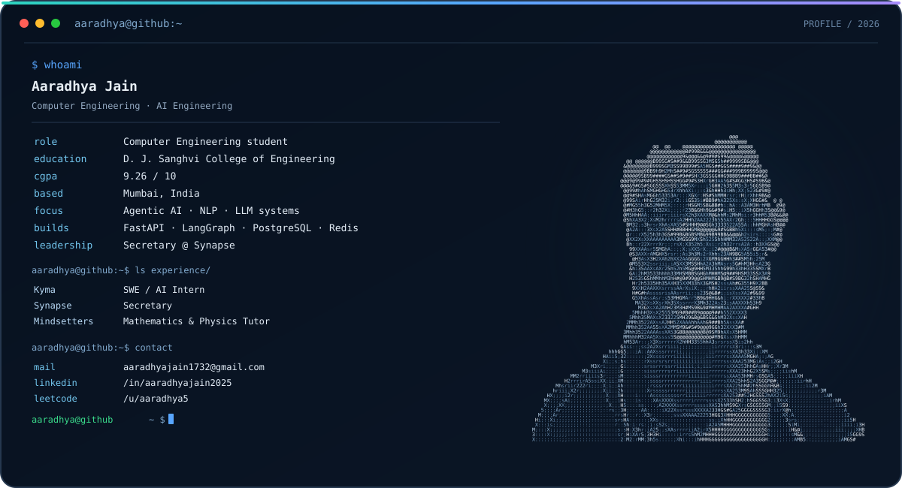
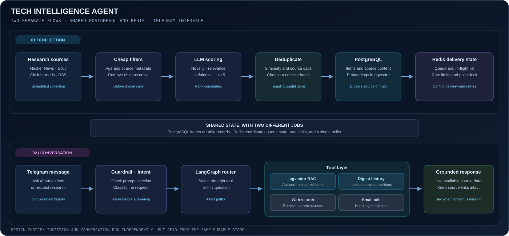
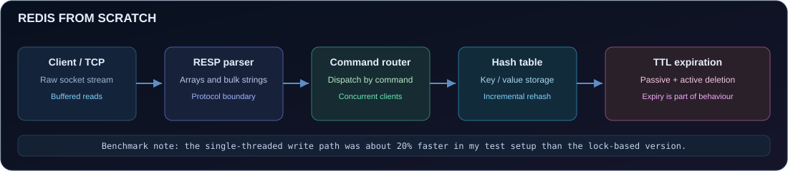
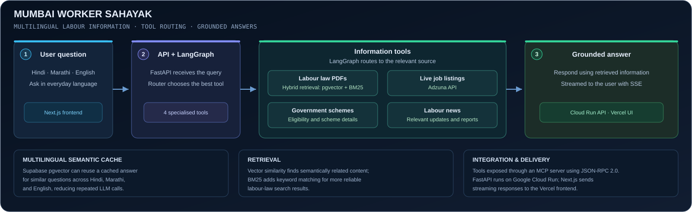

  
   
   
  
  
  
  

 

## 👋 About Me

I'm Aaradhya, a Computer Engineering student at D. J. Sanghvi College of Engineering in Mumbai. I enjoy building AI applications, but the part that interests me most is what happens around the model: how an agent decides which tool to use, how retrieval finds the right source, how memory and state are managed, and how we debug a system when it behaves differently from what we expected.

At **Kyma**, I worked on a production multi-agent LLM system and got to see how small engineering details affect the full user experience. I used traces to find an unnecessary model retry, investigated a content truncation issue, and worked on conversational agents that collect and confirm information through messaging workflows.

Outside work, I'm the **Secretary of Synapse**, the Computer Engineering committee at D. J. Sanghvi. I enjoy being part of a team that brings people together around technical events and shared interests. Teaching mathematics and physics also shaped how I learn: I like to take a confusing concept apart, understand the pieces, and explain it clearly.

My current interests are **agentic AI, NLP, retrieval systems, backend engineering, and system design**. I tend to learn best by building something, measuring what happens, then going back to understand the design choices behind it.

 

  <table>
    <tr>
      <td align="center" width="33%"><h3>🤖 Agentic AI</h3>Tool routing, state, guardrails, and evaluation</td>
      <td align="center" width="33%"><h3>🔎 Retrieval + NLP</h3>Embeddings, hybrid search, multilingual questions</td>
      <td align="center" width="33%"><h3>⚙️ Backend systems</h3>Queues, persistence, APIs, and reliability</td>
    </tr>
  </table>

---

## 💼 Experience & Leadership

<table>
  <tr>
    <td width="24%" valign="top">
      <h3>Kyma</h3>
      <b>SWE / AI Intern</b> 
      Jun 2026 to Aug 2026  
      
    </td>
    <td valign="top">
      I worked on a production multi-agent LLM system built with Python, FastAPI, LangGraph, PostgreSQL, Redis, and AWS. One part of the job was understanding why a conversation took longer than it should. I traced individual turns in LangSmith, found a redundant retry LLM call, and removed the unnecessary work. I also tracked a content truncation bug to its source instead of adding a workaround around it.
        
      I also worked on conversational flows that collect user information over WhatsApp. I designed prompt patterns and per-slot confirmation logic, modelled the journey with Pydantic schemas, and worked on the webhook and message pipeline between Meta Cloud API and the backend. A key detail was separating a value the model extracted from a value the user had actually confirmed.
        
      <b>What this taught me:</b> production AI is a full-system problem. Prompts matter, but so do state, validation, observability, retries, and the path from an incoming message to the final response.
        
      <code>Python</code> <code>FastAPI</code> <code>LangGraph</code> <code>PostgreSQL</code> <code>Redis</code> <code>LangSmith</code> <code>AWS</code> <code>Pydantic</code>
    </td>
  </tr>
  <tr>
    <td width="24%" valign="top">
      <h3>Synapse</h3>
      <b>Secretary</b> 
      Computer Engineering Committee  
      
    </td>
    <td valign="top">
      As Secretary of Synapse, I help keep the committee's work organised and communication moving across the team. That includes supporting the planning and execution of technical and community initiatives, following up on details, and helping turn ideas into something students can take part in.
        
      I value this role because building a strong technical community requires more than good ideas. It takes coordination, consistency, and people who are willing to take responsibility for the less visible parts of an event. It also gives me a different way to work with people outside the code editor.
        
      <a href="https://github.com/aarugit797/Synapse_LP">View the Synapse landing page repository</a>
    </td>
  </tr>
  <tr>
    <td width="24%" valign="top">
      <h3>Mindsetters</h3>
      <b>Mathematics & Physics Tutor</b> 
      Jun 2024 to Sep 2024  
      
    </td>
    <td valign="top">
      I tutored students in algebra, calculus, and mechanics. I learned to break a problem into smaller steps, identify where a student's understanding was getting stuck, and explain the same concept in more than one way. Teaching made me more careful about checking whether an explanation actually makes sense to someone else, rather than assuming it is clear because it makes sense to me.
        
      That habit carries into engineering. When I learn a new tool or system, I try to explain what it does, why it exists, and what trade-off it makes before memorising the API.
    </td>
  </tr>
</table>

---

## 🚀 Featured Project: Tech Intelligence Agent

  
  
  

**A small research digest that filters the noise, then lets you ask follow-up questions about what it sent.**

Keeping up with technology can mean opening GitHub Trending, Hacker News, arXiv, lab blogs, and newsletters every day. This project collects items from those sources, ranks them, and sends two short digests a day on Telegram. The conversational part is what makes it more than an RSS reader: I can reply to a digest and ask the agent to explain one of the items.

  

### How the system works

| Module | What happens | Why I designed it this way |
|---|---|---|
| **Collection** | Pulls items from GitHub Trending, Hacker News, arXiv, RSS feeds, and lab blogs. | Different sources move at different speeds, so each source needs a sensible schedule and a shared place to store discovered items. |
| **Two-stage filtering** | Cheap rules remove obvious noise first. An LLM scores the remaining candidates for novelty, relevance, and applicability. | Using the model on every candidate would waste calls. A cheap first pass reduces cost before spending tokens on judgement. |
| **Selection and deduplication** | A score threshold, source caps, and semantic deduplication help select a varied set of five items. | Pure top-N ranking once produced a digest dominated by a single source. Caps are maximums, not quotas, so quality still wins. |
| **Stored content and embeddings** | PostgreSQL stores the content, while pgvector and an HNSW cosine index support retrieval with 1,024-dimensional Voyage embeddings. | Follow-up questions need access to the actual item and its stored content, not just a title remembered by the model. |
| **Conversation routing** | A LangGraph flow uses an intent classifier and guardrail to route a message to digest history, RAG, web search, or small talk. | A question about something the bot already sent should use that history. It should not have to rediscover the item. |
| **Delivery and limits** | Redis supports a queue with an in-flight list, a lock for one Telegram poller, and Lua-based sliding-window rate limiting for model credentials. | API quota exhaustion and duplicate sends are application problems, not prompt problems. They need explicit handling in the surrounding system. |
| **Tests and changes** | Two PostgreSQL databases have separate Alembic migration chains. The project includes 75 pytest tests and GitHub Actions CI. | Separating the pipeline's data from conversation data makes migrations and responsibilities easier to reason about. Tests help protect behaviour while the internals change. |

### Decisions I care about

- **Ground answers in sources.** The conversation tools answer from stored source content. When a page could not be fetched, the agent should say that instead of quietly inventing details from a title.
- **Treat delivery as a system of its own.** A Telegram update should not be treated as complete just because the poller has seen it. The acknowledgement needs to reflect successful processing and sending.
- **Keep collection and conversation independent.** A heavy ingestion run should not starve a person who is asking a question. The processes share PostgreSQL and Redis, but they have separate responsibilities.
- **Measure before making a change.** One debugging lesson was that a low token ceiling does not necessarily make an answer concise. It can simply cut off the response. Length should be shaped deliberately, while token limits act as a safety boundary.

**Stack:** Python 3.11, FastAPI, SQLAlchemy, asyncpg, PostgreSQL, pgvector, Redis, LangGraph, Voyage AI embeddings, Gemini, Groq, Alembic, APScheduler, Sentry, pytest, GitHub Actions.

[Explore the code and full architecture in the repository](https://github.com/aarugit797/telegram-news)

---

## 🧩 More Projects & Engineering Notes

### 01. Redis From Scratch

  

I built a Redis-compatible server in Go over raw TCP to understand what happens between a client issuing a command and a server storing or returning a value. The server parses RESP using buffered reads and handles each connection in a goroutine. I implemented a custom hash table with incremental rehashing, along with both passive and active TTL expiration.

I also compared a single-threaded write path with a multi-threaded design using locks. In my benchmark, the single-threaded version was about 20% faster on writes. That result belongs to my benchmark setup, not every workload, but it made the cost of lock contention much more tangible.

This project gave me a practical way to understand protocol parsing, data structures, connection handling, and the trade-offs hidden behind a familiar tool.

**Stack:** Go, TCP, RESP, hash tables, concurrency, TTL expiry.

[Read my engineering write-up: Why Is Redis So Fast? I Rebuilt It to Find Out](https://medium.com/@aaradhyajain1732/why-is-redis-so-fast-i-rebuilt-it-to-find-out-deb2d8661565)

### 02. Mumbai Worker Sahayak

  

Mumbai Worker Sahayak is a multilingual labour-assistance platform for questions that can require different sources: labour law PDFs, current job listings, government schemes, or labour news. I built a LangGraph agent with four tools so that a query could be routed toward the information source that best fit it.

For retrieval, I combined semantic search through Supabase pgvector with BM25 keyword matching. Semantic retrieval helps when the same question is phrased differently, while keyword search can be useful for names, legal terms, or specific phrases. I also added multilingual semantic caching so similar questions in Hindi, Marathi, and English could reuse a cached result. In my tests, this reduced LLM calls by roughly 60% for the relevant repeated questions.

The backend ran on Google Cloud Run with GitHub Actions and Artifact Registry for deployment. I exposed the tools through an MCP server using JSON-RPC 2.0 and streamed responses to a Next.js frontend using server-sent events.

**Stack:** Python, FastAPI, LangGraph, Google Cloud Run, Supabase pgvector, BM25, MCP, JSON-RPC 2.0, SSE, Next.js, Vercel.

[Browse my GitHub repositories](https://github.com/aarugit797?tab=repositories)

### 03. Smart Study Assistant

**NLP classification for student questions**  ·  [Repository](https://github.com/aarugit797/Smart-Study-Assistant-)

This project classifies exam-style student questions into Physics, Chemistry, Mathematics, or Biology. I started with exploratory data analysis and cleaning, checked class distribution and question lengths, handled missing values, and created a cleaned text column before feature extraction.

I used TF-IDF to represent questions numerically, with up to 8,000 features and unigrams plus bigrams. I compared Naive Bayes, Logistic Regression, and LinearSVC on validation data, then selected LinearSVC because it performed best in that comparison. The vectoriser, trained model, and label encoder were saved and connected to a Streamlit interface.

What I like about this project is that it covers the full classic NLP path: looking at the data, cleaning it, creating features, comparing models, and putting the selected model behind an interface.

**Stack:** Python, pandas, scikit-learn, TF-IDF, LinearSVC, Pickle, Streamlit.

---

## 🐍 GitHub Contribution Snake

I like having a visual record of the work I keep coming back to. This animation is generated by GitHub Actions from the contribution grid and is published to the `output` branch of this profile repository.

  

  
  

---

## 🛠️ Technical Skills

  

| Area | Tools and concepts I have worked with |
|---|---|
| **Languages** | Python, C++, SQL, Go, HTML, CSS |
| **AI, ML and NLP** | LangGraph, LangChain, RAG, embeddings, pgvector, BM25, scikit-learn, TensorFlow, Keras, NLTK |
| **Backend** | FastAPI, Flask, Django, REST APIs, webhooks, Pydantic, server-sent events |
| **Data and reliability** | PostgreSQL, MySQL, Redis, Alembic, pytest, rate limiting, queues, caching, migrations |
| **Cloud and tooling** | AWS, Google Cloud, Docker, GitHub Actions, Supabase, LangSmith, Git, VS Code, Jupyter Notebook |
| **Web** | Next.js, Streamlit, Vercel, HTML, CSS |

---

## ✍️ Writing

<table>
  <tr>
    <td width="18%" align="center" valign="middle"></td>
    <td valign="top">
      <b><a href="https://medium.com/@aaradhyajain1732/why-is-redis-so-fast-i-rebuilt-it-to-find-out-deb2d8661565">Why Is Redis So Fast? I Rebuilt It to Find Out</a></b> 
      I break down RESP, incremental rehashing, TTL expiry, skip lists, and persistence trade-offs while explaining the implementation choices behind Redis.
    </td>
  </tr>
  <tr>
    <td width="18%" align="center" valign="middle"></td>
    <td valign="top">
      <b><a href="https://medium.com/@aaradhyajain1732">NPCs in GTA 5: How Agentic Systems Can Make NPCs Feel Alive</a></b> 
      An exploration of agentic systems, autonomous decisions, and memory-driven behaviour in more believable game characters.
    </td>
  </tr>
</table>

---

## 🌱 What I'm Exploring

- **Agentic AI:** how agents choose tools, keep state, and recover when a step fails.
- **NLP and retrieval:** better search across different wording and languages, plus ways to keep answers grounded in evidence.
- **Backend and system design:** request lifecycles, data consistency, queues, persistence, concurrency, and observability.
- **Learning from first principles:** rebuilding small pieces of familiar systems to understand the decisions hidden by abstractions.

## 📬 Connect

I'm happy to talk about AI engineering, NLP, backend systems, projects built from first principles, or collaborations with student and developer communities.

  
  
  
  

 

  Built with curiosity, tested against reality, and improved one bug at a time.

